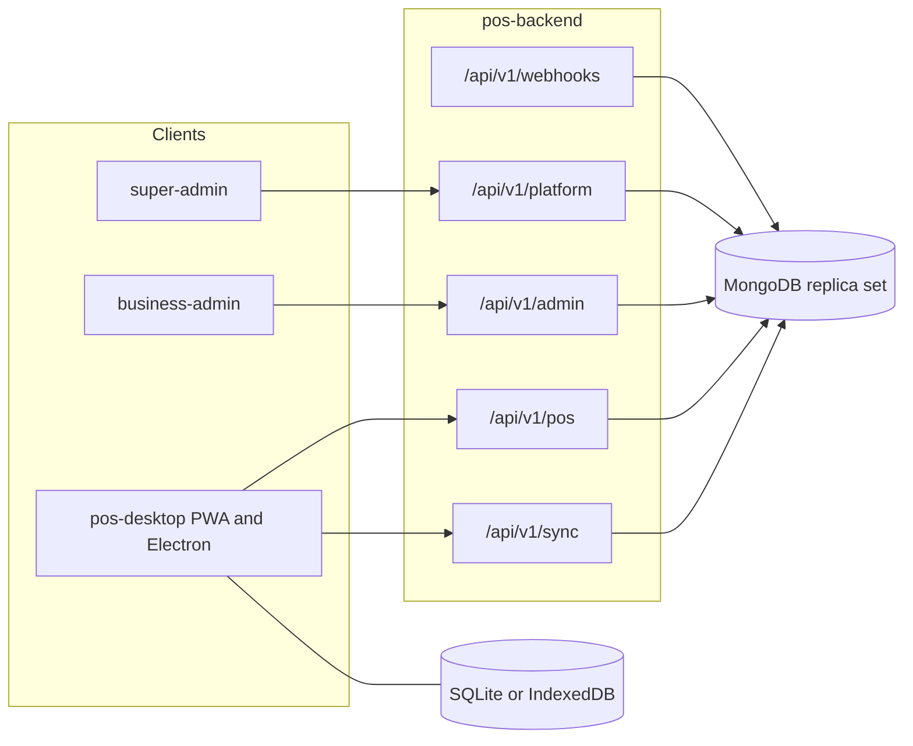
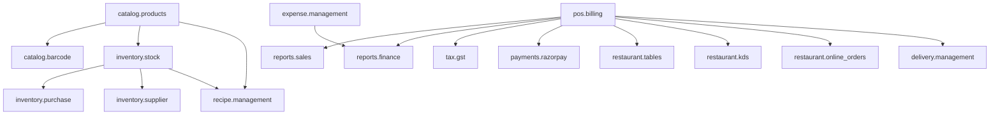

# System architecture

This document is the canonical design for the POS platform. `pos-desktop` and `pos-admin-frontend` keep only the notes a client implementer needs and follow this document for tenancy, modules, money, and HTTP.

Related records:

- [DATABASE.md](DATABASE.md) — collections, indexes, transactions
- [OFFLINE-SYNC.md](OFFLINE-SYNC.md) — terminal sync protocol
- [API.md](API.md) — HTTP catalog
- [ROADMAP.md](ROADMAP.md) — phase plan
- [adr/](adr/) — decisions and the alternatives they set aside

## Repositories

Three Git repositories stay independent. Each has its own dependencies, environment, build, and pipeline.

| Repository | Role |
| --- | --- |
| `pos-backend` | HTTP API, domain rules, MongoDB, migrations, OpenAPI |
| `pos-desktop` | POS UI for browser PWA and, from Phase 9, Electron. SQLite or IndexedDB. No Admin UI. |
| `pos-admin-frontend` | Business Admin and Super Admin as two Vite apps in one repo |

The desktop and admin apps call this API. They do not open MongoDB. Business rules for price, tax, stock, modules, and permissions live here. Clients may pre-calculate for a fast screen and must treat the server result as the stored result.

## Runtime shape



Redis and BullMQ are introduced with the first real background job. See [adr/010-defer-redis-and-bullmq.md](adr/010-defer-redis-and-bullmq.md).

## Backend application

Stack: Node.js, Express, TypeScript, MongoDB Node driver, Zod, Argon2id, JWT access tokens, rotating refresh tokens, Pino, Helmet, Vitest, Supertest. OpenAPI is generated from the route schemas once the server exists. Phase 1 records the contract in [API.md](API.md).

### Request path

```text
HTTP
  -> request id, logging, helmet, cors, rate limit
  -> authenticate (aud, session, token version)
  -> authorize (permission, module, branch)
  -> Zod parse
  -> controller
  -> service
  -> repository (MongoDB session when a transaction is required)
  -> standard JSON body
```

Controllers map HTTP to a service call and a status code. Services enforce invariants. Repositories are the only layer that touches the driver. Domain code does not import Express.

### Module folders

Each domain folder owns its routes, controller, service, repository, Zod schemas, and permission keys.

| Folder | Responsibility |
| --- | --- |
| `identity` | Login, refresh, logout, password reset, sessions, login history |
| `access` | Roles, permissions, `requireModule`, `requirePermission` |
| `platform` | Tenants, plans, module assignment, platform users, settings, health |
| `catalog` | Categories, products, variants, barcodes |
| `inventory` | Stock items, balances, movements, purchases, suppliers, transfers |
| `recipes` | Recipes, unit conversion, costing, consumption plans |
| `orders` | Pricing, orders, holds, cancellation, refunds, receipts |
| `payments` | Method registry, cash, later Razorpay |
| `expenses` | Categories, expenses, approval |
| `reports` | Aggregations and PDF, Excel, CSV export |
| `sync` | Idempotent batch apply and conflicts |
| `integrations` | Provider adapters. Partner APIs stay disabled until a real adapter ships |

Shared code under `src/common` covers errors, the response envelope, logging, ids, integer money, and the tenant scope type. It does not absorb domain rules.

### Configuration

Secrets and deployment settings come from the environment: `MONGODB_URI`, `MONGODB_DB_NAME`, token secrets, Razorpay keys, CORS origins, expected migration version. Local development is `mongodb://localhost:27017` and database `pos-db`. Tests use `pos-db-test`. Tenant ids, prices, modules, and permissions are data, never environment fallbacks.

## Dynamic modules

A business sees only the modules assigned to it. The registry is data in `module_definitions`. Assignment is data in `tenant_modules`.

Enabling a module fails while any dependency is disabled. Disabling a module fails while another enabled module depends on it. The check is transactional so two admins cannot leave a tenant with a broken graph.

In the diagram, an arrow points from the module that must already be enabled to the module that requires it. Modules with no dependency are omitted.



`employee.management` and `customer.management` have no dependency. They are assigned on their own.

Initial permission keys ship with the module that owns them. A custom role may include a key only when that module is enabled for the tenant. Assigning a module does not grant the key to existing custom roles. The Business Owner preset receives the new keys. Other presets receive the keys defined for that preset.

`requireModule` and `requirePermission` run on every protected route. Bootstrap payloads tell the shells which navigation to show. A hidden screen is not an access control.

### What each module covers

| Code | Behaviour when enabled |
| --- | --- |
| `pos.billing` | Shifts, tickets, holds, cash tender, receipts |
| `catalog.products` | Categories, products, variants, prices |
| `catalog.barcode` | Unique barcode lookup |
| `inventory.stock` | Balances, movements, adjustments, transfers, low stock |
| `inventory.purchase` | Purchase documents that post stock in |
| `inventory.supplier` | Supplier records used by purchases |
| `recipe.management` | Recipes, conversion, cost, ingredient consumption |
| `expense.management` | Expense categories, entries, approval |
| `employee.management` | Tenant users beyond the owner, role assignment |
| `customer.management` | Customer directory on the ticket |
| `reports.sales` | Sales summaries and product rankings |
| `reports.finance` | Profit estimate and expense reports |
| `tax.gst` | GSTIN, HSN, CGST/SGST or IGST components |
| `payments.razorpay` | Server-created Razorpay orders and verified webhooks |
| `restaurant.tables` | Tables and dine-in order type |
| `restaurant.kds` | Kitchen states and the prepare-time stock policy |
| `restaurant.online_orders` | Online order type and status |
| `delivery.management` | Delivery status on an order |

Cafe, restaurant, and retail are assignment sets, not separate applications. A cafe without dine-in is not given `restaurant.tables`. A trader is not given kitchen modules.

### Module settings

Business profile and stock policy live on the tenant: legal name, currency, timezone, tax mode (`inclusive` or `exclusive`), and `stockPolicy` (`on_payment` or `on_prepared`). `on_prepared` can be selected only when `restaurant.kds` is enabled.

Per-module options live on `tenant_modules.settings`. Examples: hold orders and partial cash on `pos.billing`; receipt footer on `pos.billing`; default GST rate on `tax.gst`. Settings are validated against the schema stored on the module definition. Unknown keys are rejected.

## Tenancy and branches

One shared database. Business documents include `tenantId`. Repositories take a `TenantScope` and always filter by it. Details and the rejected alternatives are in [adr/004-shared-database-multi-tenancy.md](adr/004-shared-database-multi-tenancy.md).

A tenant has many branches. Balances, terminals, shifts, orders, purchases, and expenses belong to a branch. Users carry `branchIds`. A request whose branch is outside that set returns 403. Business Owner is scoped to every branch of the tenant.

Platform staff act on a tenant by id through `/api/v1/platform`. They do not receive a tenant access token for daily admin work. Support flows that need tenant data are explicit platform routes and are audit-logged.

Tenant status:

| Status | Effect |
| --- | --- |
| `active` | Tenant users may authenticate |
| `inactive` | Owner can sign in to read; POS and writes are rejected |
| `suspended` | All tenant authentication is rejected |
| `deleted` | Soft-deleted. Authentication is rejected. Documents stay for the backup window |

## Identity and permissions

### Audiences

Access tokens set `aud` to `platform` or `tenant`. Platform routes reject tenant tokens. Tenant routes reject platform tokens. Claims include `sub`, `aud`, `sessionId`, `tv` (token version), and for tenant tokens `tenantId`, `roleId`, and `branchIds`.

Permission lists stay out of the token. Each request loads the role and compares `tv` with the user document so a disabled user or an edited role fails closed. An in-process cache of at most 30 seconds is allowed. Bumping `tv` revokes access tokens immediately because the version no longer matches.

### Token lifetimes

| Token | Lifetime | Storage |
| --- | --- | --- |
| Access | 15 minutes | Memory in the SPA. Desktop renderer memory. |
| Refresh | 30 days, rotating | HttpOnly `SameSite=Strict` cookie on the web. OS secure storage in Electron. |
| Password reset | 30 minutes, single use | Only a hash is stored |

Refresh reuse revokes the whole session family. Logout revokes the family. Login history records success and failure. Sessions can be listed and revoked by an administrator of the same audience.

Passwords are hashed with Argon2id.

### Platform roles

| Role | Scope |
| --- | --- |
| Super Admin | Full platform permission set |
| Platform Administrator | Tenants, modules, plans, platform users. No destructive global setting unless granted |
| Support Administrator | Read tenants, read health, read audit. No module assignment unless granted |

### Tenant preset roles

Presets are system roles copied into the tenant at creation. Owners may clone them into custom roles. Preset documents with `isSystem: true` cannot be deleted. Their keys can be edited by Business Owner except the owner's own `access.role.manage` key, which stays so the tenant cannot lock itself out.

| Preset | Intended keys |
| --- | --- |
| Business Owner | Every key of every enabled module, plus settings and role management |
| Business Admin | Same operational keys, except platform billing contact changes |
| Manager | Sales, refunds within a limit stored on the role, inventory read, expenses draft |
| Cashier | POS sell, hold, cash tender, own shift. No inventory adjust, no reports export |
| Inventory Manager | Stock, purchases, suppliers, recipes |
| Accountant | Expenses, finance reports, tax, payment reconciliation. No POS sell |
| Kitchen Staff | KDS state changes when `restaurant.kds` is enabled |

Custom roles store a name and a list of permission keys. Keys from a disabled module are stripped at save time and ignored at check time.

Permission keys used by [API.md](API.md):

- POS: `pos.order.create`, `pos.order.hold`, `pos.order.cancel`, `pos.order.refund`, `pos.shift.manage`
- Catalog: `catalog.product.read`, `catalog.product.write`
- Inventory: `inventory.balance.read`, `inventory.movement.write`, `inventory.purchase.read`, `inventory.purchase.write`, `inventory.supplier.read`, `inventory.supplier.write`
- Recipes: `recipe.read`, `recipe.write`
- Expenses: `expense.read`, `expense.write`, `expense.approve`
- Reports: `report.sales.read`, `report.finance.read`, `report.export`
- People: `employee.user.read`, `employee.user.write`, `access.role.read`, `access.role.manage`, `customer.read`, `customer.write`
- Settings: `settings.business.read`, `settings.business.write`, `settings.module.read`, `settings.module.write`
- Platform: `platform.tenant.read`, `platform.tenant.write`, `platform.tenant.status`, `platform.module.read`, `platform.module.write`, `platform.module.assign`, `platform.plan.read`, `platform.plan.write`, `platform.user.read`, `platform.user.write`, `platform.integration.read`, `platform.integration.write`, `platform.settings.read`, `platform.settings.write`, `platform.audit.read`

## Catalog, stock, and recipes

Sellable products and counted stock are different documents. See [adr/009-products-and-stock-items.md](adr/009-products-and-stock-items.md).

Product types:

| Type | Stock effect on sale |
| --- | --- |
| `simple` | One movement on `stockItemId` when inventory is enabled |
| `variant` | One movement on the variant's `stockItemId` |
| `recipe` | One movement per recipe line |
| `service` | None |

A retail product that tracks stock is `simple` or `variant` with a linked stock item. A sandwich is `recipe`.

### Units and the sandwich example

Stock quantities are integers in the item's base unit (`mg`, `ml`, or `milli_each`). Display units convert at the API edge. Details of rounding are in [DATABASE.md](DATABASE.md).

Onion stock item, base unit `mg`:

- Purchase 100 kg = 100,000,000 mg
- Sandwich line: 100 g onion = 100,000 mg, plus tomato 50 g, cheese 20 g, bread 2 slices, butter 10 g
- One sandwich consumes 100,000 mg of onion. On-hand becomes 99,900,000 mg, which displays as 99.9 kg
- One hundred sandwiches consume 10,000,000 mg. On-hand displays as 90 kg

Wastage on a line is basis points added to consumption. Order lines store `qtyMilli`, where 1000 equals one product. One sandwich is `1000`. A cashier quantity of 10 is `10000`.

```text
consumed = roundHalfUp(qtyBase * qtyMilli / 1000 * (10000 + wastageBps) / 10000)
```

### When stock moves

`stockPolicy = on_payment` (default): movements post in the same transaction as the capturing payment.

`stockPolicy = on_prepared`: sending a ticket to the kitchen writes `reservation` movements and increases `reservedBase`. Marking it prepared converts the reservation into `recipe_consumption` or `sale` and decreases `reservedBase` and `onHandBase`. Cancel before preparation writes `reservation_release`. Cancel after preparation does not put ingredients back. It writes a `wastage` movement only when the ingredients were not already consumed, and it records the refund as money. If they were already consumed, the wastage is the consumption itself; the refund does not create a second stock row.

Movements are append-only. A mistake is a `reversal` movement that points at the original id. The unique idempotency key on the movement prevents a retried sale from deducting twice.

### Cost and profit

Latest purchase cost on the stock item is copied onto the order line at sale time as `unitCostMinor`. COGS for the line is that snapshot. Later purchase prices do not change closed tickets.

Definitions used by reports and the dashboard:

```text
grossSales        = sum of line extended prices before discount
discounts         = sum of discounts
refunds           = sum of completed refund amounts, excluding tax where tax was reversed
netSalesExTax     = grossSales - discounts - refundsExTax - taxCollected
cogs              = sum of snapshotted line costs for sold lines that were not fully restocked
grossProfit       = netSalesExTax - cogs
operatingExpenses = sum of approved expenses in the period whose category kind is operating
operatingProfitEstimate = grossProfit - operatingExpenses
```

Tax collected is a liability, not revenue and not profit. The UI label for the last line is "Operating profit estimate". It is not labelled net profit. Depreciation, income tax, and owner drawings are outside this figure.

Margin percent for a product in a period is `grossProfit * 10000 / netSalesExTax` in basis points when net sales are non-zero.

## Orders and payments

Order states: `draft`, `held`, `open`, `paid`, `completed`, `cancelled`, `refunded`.

Kitchen states, present only when KDS is enabled: `sent`, `preparing`, `prepared`, `served`.

A completed cash sale moves `open` to `paid` in one request. `completed` is set when stock policy has been satisfied and the receipt is issued. For `on_payment` that is the same transaction as `paid`. For `on_prepared`, `paid` can precede `completed`.

Payment methods in the core registry: `cash`, `upi`, `card`, `razorpay`. A tenant enables a subset in settings. Offline terminals capture `cash` only. UPI, card, and Razorpay require a network call. Gateway capture requires `payments.razorpay`. The server creates the Razorpay order and returns the public key id.

Razorpay secret and webhook secret stay in the server environment. The client receives the public key id and the Razorpay order id. The server verifies the payment signature and the webhook signature. A provider event id is unique in `payments` or `sync_inbox` so a replay does not capture twice.

Partial payment is allowed only when `pos.billing` settings say so. The order stays `open` until the captured sum equals `totalMinor`. Split tender is several `payments` rows on one order.

Refunds create a `refunds` document and reduce the captured balance. They do not delete the payment.

## Integrations

The integrations module defines a provider adapter:

```text
health()
pullOrders(since)
pushOrderStatus(orderId, status)
syncCatalog() when the provider documents a catalog API
```

Each method returns a typed result or a typed unavailable error. There is no adapter that invents orders.

| Provider | Phase 1 finding | Server behaviour until a real adapter exists |
| --- | --- | --- |
| Razorpay | Public API, merchant keys, signature verification | Implemented in Phase 8 |
| Swiggy | Partner POS program. No open self-serve API for an arbitrary merchant | `partner_only`. Routes answer 501 with code `integration_unavailable` |
| Zomato | POS partner API under commercial approval | `partner_only`. Same error |
| Porter | Partner logistics API, not an open booking API for every tenant | `partner_only`. Same error |

`integration_logs` records each attempt, the provider code, and whether it will be retried. Retries start when BullMQ arrives with the first live adapter.

## Security

- Argon2id passwords, rotating refresh tokens, audience separation, tenant scope from the token.
- Zod on every body and query. MongoDB filters are built from parsed fields, not from client objects spread into a query.
- Helmet, an explicit CORS allow-list, and rate limits on login, refresh, and password reset.
- JSON responses. User-supplied strings are stored and returned as data. HTML rendering is a client responsibility with normal escaping.
- Cookie refresh tokens use `SameSite=Strict` and `Secure` outside local HTTP. CSRF tokens are unnecessary for the bearer access-token calls. Cookie-authenticated refresh is same-site only.
- Uploads (logo, product image, expense receipt) declare purpose, max size, and an allow-list of content types. Bytes go to object storage configured by environment, not into the Git repo. Metadata is a `files` document.
- Audit log on tenant status changes, role edits, module assignment, refunds, stock adjustments, price changes, and expense approvals.
- Production error bodies contain `code`, `message`, `requestId`, and safe `details`. They omit stack traces, driver messages, and secrets.
- Backups run before production migrations. The API refuses to start when `schema_migrations` is behind the build.

## Observability

Every request gets a `requestId` and a structured Pino log line. Payment failures, sync conflicts, and integration failures log the domain id and the error code. Health:

- `GET /api/v1/health` — process up
- `GET /api/v1/health/ready` — MongoDB reachable and migration version current

## Testing bar

A phase is unfinished until its tests pass in this repository:

- Integer pricing, discount, GST inclusive and exclusive, margin
- Recipe consumption including the onion example and wastage basis points
- Permission denied, module disabled, and cross-tenant read
- Idempotent order and movement retry
- Concurrent sale transactions that both decrement the same balance
- Offline batch: two terminals, negative on-hand, conflict row, no lost sale

The end-to-end cafe journey (create tenant, assign modules, recipe, stock in, sell, expense, export) is a Playwright flow in Phase 10, with the API portion covered earlier by Supertest as each phase lands.

## Clients

Business Admin and Super Admin screen maps live in `pos-admin-frontend`. POS screen maps and the local database live in `pos-desktop`. Both treat [API.md](API.md) as the contract they generate against.
