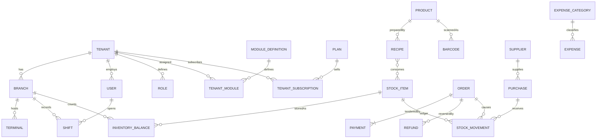

# Database

MongoDB is the server database. SQLite is a terminal store and is specified in `pos-desktop`. This document is the server schema.

Decisions: [adr/001-mongodb-as-only-server-database.md](adr/001-mongodb-as-only-server-database.md), [adr/003-integer-money-and-quantities.md](adr/003-integer-money-and-quantities.md), [adr/005-uuid-public-identifiers.md](adr/005-uuid-public-identifiers.md).

## Local connection

| Variable | Value |
| --- | --- |
| `MONGODB_URI` | `mongodb://localhost:27017` |
| `MONGODB_DB_NAME` | `pos-db` |
| `MONGODB_DB_NAME_TEST` | `pos-db-test` |

These values are in `.env.example`. The application reads them from the environment. `pos-db` holds the initial collections created by `migrations/20261104194900-create-initial-collections.js`. Automated tests use `pos-db-test` on the same server so a test run cannot wipe development data. Apply the same migration there before tests run.

The running mongod has no replica set name. Single-document writes succeed. A sale that must commit an order, a payment, and stock movements in one transaction needs a replica set. Initializing one on this same host, without changing the URI or the database name:

```text
mongosh mongodb://localhost:27017 --eval 'rs.initiate({_id:"rs0",members:[{_id:0,host:"localhost:27017"}]})'
```

That command changes the local server for every database on it, so it waits for an explicit decision. Until then, migration and health checks can use `pos-db`, and transaction tests stay blocked.

## Migrations

Tool: `migrate-mongo`.

History collection: `schema_migrations`.

Directory: `pos-backend/migrations/`, one file per change, timestamp prefix, `up` and `down`.

Scripts:

- `npm run migrate:create`
- `npm run migrate:up`
- `npm run migrate:down`
- `npm run migrate:status`

Config file: `migrate-mongo-config.js`. It reads `MONGODB_URI` and `MONGODB_DB_NAME`.

The first applied migration is `20261104194900-create-initial-collections.js`. It creates every collection in this document, the indexes below, JSON Schema validators, the `system_settings` document `_id = "global"`, and the four integration providers. `down` drops those collections and does not drop `schema_migrations`.

`up` creates collections, indexes, and JSON Schema validators, and may backfill. Backfills are written so a second run is a no-op. `down` reverses the step when that is possible. A migration that destroys data documents why `down` cannot restore it and requires a backup.

The API process never calls `up`. A deploy applies migrations, then starts the build whose `EXPECTED_MIGRATION` matches the latest file. Boot reads `schema_migrations` and exits if the applied version is older.

Environments: local (`pos-db`), test (`pos-db-test`), staging, and production. Staging and production supply their own URI and database name. Production runs `up` only as a controlled step after a backup.

## Identifiers, money, and quantity

`_id` is a MongoDB ObjectId on every collection below. The API returns that id as a 24-character hex string.

| Concept | Storage | API boundary |
| --- | --- | --- |
| Money | Int64 minor units (`amountMinor`) | Decimal string in tenant currency |
| Rate | Int32 basis points | Decimal percent string |
| Mass | Int64 milligrams | Decimal plus `g` or `kg` |
| Volume | Int64 millilitres | Decimal plus `ml` or `l` |
| Count | Int64 milli-each (1000 = 1 display unit) | Decimal plus the item display unit |

Half-up rounding is used when a division remains. Line tax and line wastage each round once, then the order sums the lines.

Latest purchase cost is an integer on the stock item and a snapshot on the order line. The snapshot is the cost used for COGS.

## Relationships



Embedded, not separate collections: product variants, recipe lines, purchase lines, order lines, tax components. They are always read and written with the parent. Barcodes are a collection because lookup is by code, not by product.

There is no database-level foreign key. Services check references inside a transaction before writing. Orphan checks are part of the service tests.

## Transactions

Required replica set. These flows use one session:

| Flow | Documents |
| --- | --- |
| Paid sale, stock on payment | `orders`, `payments`, `stock_movements`, `inventory_balances`, `sequences` |
| Send to kitchen | `orders`, reservation movements, balances |
| Prepared | `orders`, consumption movements, balances |
| Cancel before prep | `orders`, release movements, balances |
| Receive purchase | `purchases`, movements, balances, `stock_items` latest cost |
| Refund | `refunds`, `payments`, `orders` |
| Enable or disable module | `tenant_modules` for the tenant |
| Create tracked product | `products`, `stock_items`, `barcodes` |

Balance update and movement insert share the session. A movement is inserted only when `idempotencyKey` is new (`upsert` on the unique index, or insert plus duplicate-key handling that returns the original).

## Platform collections

### `platform_users`

`email` (unique), `name`, `passwordHash`, `roleId`, `status` (`active` or `disabled`), `tv` (int).

### `platform_roles`

`code` (unique), `name`, `permissionKeys` (string array).

### `platform_sessions`

`userId`, `refreshTokenHash`, `familyId`, `expiresAt`, `revokedAt`, `replacedBySessionId`, `userAgent`, `ip`.

Index: `refreshTokenHash` unique, `familyId`, `userId`.

### `tenants`

`name`, `legalName`, `slug` (unique), `status` (`active`, `inactive`, `suspended`, `deleted`), `ownerEmail`, `phone`, `address`, `currency` (default `INR`), `minorUnitScale` (default 2), `timezone`, `logoFileId`, `gstin`, `taxMode` (`inclusive` or `exclusive`), `stockPolicy` (`on_payment` or `on_prepared`), `planId`, `deletedAt`.

Index: `status`.

### `plans`

`code` (unique), `name`, `description`, `moduleCodes`, `limits` (`branches`, `terminals`, `users`), `priceMinor`, `interval`, `status`.

### `tenant_subscriptions`

`tenantId`, `planId`, `status`, `currentPeriodStart`, `currentPeriodEnd`.

Index: `tenantId` unique while status is `active` (partial index).

### `module_definitions`

`code` (unique), `name`, `description`, `dependencies` (string array), `permissions` (array of `{ key, description }`), `settingsSchema`, `status` (`active` or `deprecated`).

### `tenant_modules`

`tenantId`, `moduleCode`, `enabled`, `settings`, `assignedBy`, `assignedAt`.

Unique index: `(tenantId, moduleCode)`.

### `integration_providers`

`code` (unique), `name`, `availability` (`unavailable`, `partner_only`, `enabled`), `notes`.

Seed: `razorpay` becomes `enabled` in Phase 8. `swiggy`, `zomato`, `porter` stay `partner_only`.

### `tenant_integrations`

`tenantId`, `providerCode`, `enabled`, `credentialRef`, `status`, `lastHealthAt`.

Unique index: `(tenantId, providerCode)`. `credentialRef` points at a secret in the process environment or a later secret store. Raw provider secrets are not returned by read APIs.

### `system_settings`

Single document `_id = "global"`. Keys are added by migration, not by an arbitrary client map. Known keys will include support contacts and feature kill-switches.

### `schema_migrations`

Reserved for `migrate-mongo`. Application code does not insert domain data here.

## Business collections

Unless noted, every document has `tenantId`, `createdAt`, and `updatedAt`. Indexes that do not mention `tenantId` are incomplete; the list below includes it.

### `branches`

`name`, `code`, `address`, `phone`, `timezone`, `status`, `receiptPrefix`.

Unique: `(tenantId, code)`.

### `sequences`

`_id` format `{tenantId}:{branchId}:receipt`. `value` int. Updated with `findOneAndUpdate` `$inc` inside the sale transaction.

### `users`

`email`, `name`, `phone`, `passwordHash`, `roleId`, `branchIds`, `status` (`active` or `disabled`), `tv`.

Unique: `(tenantId, email)`.

### `roles`

`name`, `presetCode` (nullable), `permissionKeys`, `isSystem`.

Unique: `(tenantId, name)`.

### `user_sessions`

Same shape as `platform_sessions`, plus `tenantId`.

Index `(tenantId, userId)`, plus unique `refreshTokenHash` and `familyId`.

### `login_history`

`audience`, `userId`, `success`, `ip`, `userAgent`, `at`. Index `(tenantId, at)` and `(userId, at)`.

### `audit_logs`

`actorId`, `actorAudience`, `action`, `entityType`, `entityId`, `before`, `after`, `requestId`, `ip`, `at`. `tenantId` is null for platform actions.

Index: `(tenantId, at)`, `(entityType, entityId)`.

### `categories`

`parentId`, `name`, `sortOrder`, `status`. Index `(tenantId, parentId, sortOrder)`.

### `products`

`name`, `description`, `categoryId`, `type` (`simple`, `variant`, `recipe`, `service`), `sku`, `stockItemId`, `status` (`active` or `archived`), `imageFileIds`, `sellingPriceMinor`, `discountBps`, `taxRateBps`, `hsnCode`, `unitCode`, `trackInventory`, `variants`.

Variant element: `id`, `name`, `sku`, `sellingPriceMinor`, `stockItemId`, `status`.

Unique: `(tenantId, sku)` sparse. Index `(tenantId, categoryId, status)`, text index on `name` in Phase 4.

Archived products remain on old orders by snapshot. They are omitted from POS search.

### `barcodes`

`code`, `productId`, `variantId`. Unique `(tenantId, code)`.

### `stock_items`

`name`, `kind` (`ingredient`, `finished`, `retail`, `packaging`), `sku`, `baseUnit` (`mg`, `ml`, `milli_each`), `displayUnit`, `purchaseCostMinor`, `minQtyBase`, `trackExpiry`, `trackBatch`, `status`.

Unique: `(tenantId, sku)` sparse.

### `inventory_balances`

`branchId`, `stockItemId`, `onHandBase`, `reservedBase`, `version`.

Unique `(tenantId, branchId, stockItemId)`.

`onHandBase` changes only by applying a movement in the same transaction. `version` increments for diagnostics. Sync does not match on `version`, because offline terminals cannot share a lock. See [OFFLINE-SYNC.md](OFFLINE-SYNC.md).

Available to sell for a policy that reserves stock is `onHandBase - reservedBase`. The server still accepts an offline sale that drives on-hand negative and records a conflict.

### `stock_movements`

`branchId`, `stockItemId`, `type`, `qtyBase` (signed; negative leaves stock), `unitCostMinor`, `orderId`, `orderLineId`, `purchaseId`, `recipeId`, `idempotencyKey`, `reason`, `occurredAt`, `createdBy`, `batchCode`, `expiryDate`, `reversesMovementId`.

`type` is one of `purchase`, `sale`, `recipe_consumption`, `adjustment`, `transfer_out`, `transfer_in`, `wastage`, `reservation`, `reservation_release`, `reversal`.

Unique `(tenantId, idempotencyKey)`. Index `(tenantId, branchId, stockItemId, occurredAt)`, `(tenantId, orderId)`.

### `recipes`

`productId`, `variantId`, `version`, `yieldQty`, `status` (`active` or `archived`), `lines`, `notes`.

Line: `stockItemId`, `qtyBase`, `wastageBps`, `substitutes` (array of `{ stockItemId, qtyBase }`).

Partial unique index: one `active` recipe per `(tenantId, productId, variantId)`.

Consumption for a line, before substitutes. `qtyMilli` of 1000 is one product:

```text
consumed = roundHalfUp(qtyBase * qtyMilli / 1000 * (10000 + wastageBps) / 10000)
```

A half portion is a variant or a `qtyMilli` of 500, not a float on the recipe line. Half-up rounding runs once on the whole expression.

Substitutes are explicit cashier or KDS choices stored on the order line. They replace the matching recipe line's stock item and quantity. They are not guessed.

### `suppliers`

`name`, `phone`, `gstin`, `address`, `status`. Index `(tenantId, name)`.

### `purchases`

`branchId`, `supplierId`, `status` (`draft`, `received`, `cancelled`), `invoiceNumber`, `purchasedAt`, `lines`, `totalMinor`.

Index `(tenantId, branchId, status)`.

Line: `stockItemId`, `qtyBase`, `unitCostMinor`, `batchCode`, `expiryDate`.

Receiving posts one `purchase` movement per line and sets `stock_items.purchaseCostMinor` to that line's cost. Draft rows do not move stock.

### `customers`

`name`, `phone`, `email`, `notes`. Unique sparse `(tenantId, phone)`.

### `terminals`

`branchId`, `name`, `code`, `status`, `printer` (`interface`, `width`, `copies`), `lastSeenAt`.

Unique `(tenantId, code)`.

### `shifts`

`branchId`, `terminalId`, `userId`, `openedAt`, `closedAt`, `openingCashMinor`, `closingCashMinor`, `status` (`open` or `closed`).

Index `(tenantId, terminalId, status)`.

### `orders`

`branchId`, `terminalId`, `shiftId`, `receiptNumber`, `offlineReceiptRef`, `status`, `kitchenStatus`, `orderType` (`counter`, `dine_in`, `takeaway`, `delivery`, `online`), `tableId`, `customerId`, `lines`, `subtotalMinor`, `discountMinor`, `taxMinor`, `totalMinor`, `taxMode`, `idempotencyKey`, `paidAt`, `cancelledAt`, `cancellation`.

Line: `id`, `productId`, `variantId`, `name`, `qtyMilli`, `unitPriceMinor`, `discountMinor`, `taxMinor`, `recipeId`, `recipeVersion`, `unitCostMinor`, `lineCostMinor`, `substitutes`.

`cancellation`: `reason`, `prepared` (boolean).

Unique `(tenantId, idempotencyKey)`. Unique sparse `(tenantId, branchId, receiptNumber)`. Index `(tenantId, branchId, createdAt)`, `(tenantId, status)`.

Server-side price computation overwrites client totals before insert. The stored line is the snapshot.

### `payments`

`orderId`, `method` (`cash`, `upi`, `card`, `razorpay`), `status` (`pending`, `captured`, `failed`, `refunded`), `amountMinor`, `provider`, `providerOrderId`, `providerPaymentId`, `providerEventId`, `idempotencyKey`.

Unique `(tenantId, idempotencyKey)`. Unique sparse `(tenantId, providerEventId)`.

### `refunds`

`orderId`, `paymentId`, `amountMinor`, `reason`, `status`, `idempotencyKey`.

Unique `(tenantId, idempotencyKey)`. Index `(tenantId, orderId)`.

### `invoices`

`orderId`, `number`, `fileId`, `issuedAt`. Unique `(tenantId, number)`.

### `expense_categories`

`name`, `kind` (`operating`, `cogs`, `other`), `status`. Unique `(tenantId, name)`.

Only `operating` enters the operating profit estimate. `cogs` is informational and must not be added again on top of snapshotted order COGS.

### `expenses`

`branchId`, `categoryId`, `title`, `description`, `amountMinor`, `paidBy` (`cash`, `upi`, `card`, `bank`), `employeeId`, `supplierId`, `spentAt`, `status` (`draft`, `pending_approval`, `approved`, `rejected`), `receiptFileIds`, `recurring`.

`recurring`: `frequency` (`daily`, `weekly`, `monthly`), `nextAt`, or null.

Index `(tenantId, branchId, spentAt)`, `(tenantId, status)`.

### `tax_configs`

`name`, `rateBps`, `components` (array of `{ name, rateBps }`), `isDefault`. The sum of components equals `rateBps`. Example: CGST 900 and SGST 900 for an 18 percent rate.

Index `(tenantId, isDefault)`.

### `notifications`

`userId`, `type`, `title`, `body`, `readAt`. Index `(tenantId, userId)`.

### `files`

`purpose` (`logo`, `product`, `receipt`, `expense`), `storageKey`, `mime`, `size`, `createdBy`. Index `(tenantId, purpose)`.

### `sync_inbox`

`terminalId`, `idempotencyKey`, `entityType`, `entityId`, `result` (`applied`, `duplicate`, `conflict`), `receivedAt`.

Unique `(tenantId, idempotencyKey)`.

### `sync_conflicts`

`terminalId`, `kind` (`oversell`, `stale_catalog`), `entityType`, `entityId`, `onHandBase`, `details`, `status` (`open` or `resolved`), `resolvedBy`, `resolvedAt`.

Index `(tenantId, status)`.

### `integration_logs`

`providerCode`, `operation`, `requestId`, `success`, `errorCode`, `attempt`, `at`. Index `(tenantId, providerCode, at)`. `tenantId` is absent on a platform-level attempt.

## Worked stock numbers

Purchase onion, 100 kg, base `mg`:

| Event | Delta mg | On hand mg | Display kg |
| --- | ---: | ---: | ---: |
| Receive purchase | +100,000,000 | 100,000,000 | 100 |
| Sell 1 sandwich at 100 g | −100,000 | 99,900,000 | 99.9 |
| Sell 100 sandwiches at 100 g | −10,000,000 | 90,000,000 if starting from 100 kg | 90 |

The 100-sandwich row is an illustration from a 100 kg start, matching the product requirement, not a second deduction after the single sandwich.

## Document ownership

| Owner | Collections |
| --- | --- |
| Platform staff | `platform_*`, `tenants`, `plans`, `tenant_subscriptions`, `module_definitions`, `system_settings`, `integration_providers` |
| Platform staff, audited, targeting one tenant | `tenant_modules`, `tenant_integrations` |
| Tenant | Every other business collection in this document |

A tenant user query that omits `tenantId` is a bug. A platform user query that reads a business collection must pass an explicit tenant id that the route has authorized.
