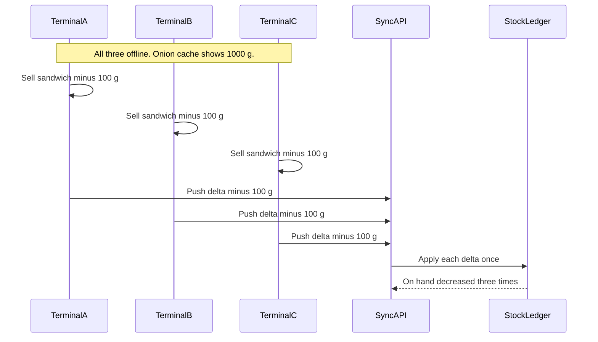

# Offline synchronization

Canonical server protocol. The desktop client store is described in `pos-desktop` and must follow this document.

Decision: [adr/008-offline-stock-deltas.md](adr/008-offline-stock-deltas.md).

## What works offline

A terminal that has completed a bootstrap while online can:

- List cached products and categories
- Scan barcodes that are in the cache
- Create orders and cash payments
- Apply local stock deltas for those orders
- Print a receipt that shows a temporary reference
- Show the local order history and the outbox

These actions need the network:

- Login and refresh when no valid local session remains
- Razorpay and any other gateway capture
- Catalog, price, recipe, user, and settings edits
- Report export
- Module assignment

The service worker caches the application shell. It is not the sync engine. Background Sync is not required and is not assumed.

## Local state

Desktop Electron uses SQLite. The browser PWA uses IndexedDB. The logical tables match.

| Local table | Contents |
| --- | --- |
| `meta` | Catalog version, last successful sync, terminal id, branch id |
| `catalog` | Products, categories, barcodes, recipes needed to explode a sale, price snapshots |
| `balances` | Last known `onHandBase` and `reservedBase`, marked as a cache |
| `outbox` | Append-only operations waiting to push |
| `orders` | Local copies, including synced rows for history |

Outbox row: `id` (UUID), `idempotencyKey`, `entityType` (`order`, `payment`, `movement`), `payload`, `state` (`pending`, `sending`, `synced`, `conflict`), `attempts`, `lastError`.

The local balance cache is a display hint. The outbox payload carries deltas, not a replacement on-hand number.

## Identifiers

The terminal generates UUID v7 ids for the order, each payment, and each movement before the sale is stored locally. Those ids are the server `_id` values. Receipt display uses `offlineReceiptRef` (`OFF-{terminalCode}-{n}`) until sync returns `receiptNumber`.

`idempotencyKey` is `{terminalId}:{entityType}:{id}`.

## Push

When the client observes connectivity it sends batches to `POST /api/v1/sync/batches`.

```json
{
  "terminalId": "uuid",
  "catalogVersion": "string-from-last-bootstrap",
  "operations": [
    {
      "idempotencyKey": "term:order:uuid",
      "entityType": "order",
      "entityId": "uuid",
      "payload": {}
    }
  ]
}
```

Order of operations inside a sale: order, movements, payment. The server applies a batch in that order inside one transaction per sale group. The client sets `groupId` on each operation so a payment is not captured if the order insert failed validation.

The server, for each operation:

1. If `idempotencyKey` exists in `sync_inbox` or on the entity unique index, return `duplicate` and the stored document. Do not move stock again.
2. Validate the payload with the same Zod schema as the online route. Recompute price, tax, and recipe consumption from the snapshotted product ids and the recipe version. If the catalog version mismatches, still accept the sale when the line includes the sold name, price, tax, and recipe version. Add a `stale_catalog` conflict for review. Reject the sale when those snapshots are missing.
3. Insert the entity and apply movement deltas to `inventory_balances`.
4. If `onHandBase` becomes negative, insert `sync_conflicts` with `kind = oversell` and still commit.
5. Assign `receiptNumber` from `sequences` when the order is new.
6. Write `sync_inbox`.

Response, one entry per operation: `applied`, `duplicate`, or `rejected`, plus `conflicts`. `rejected` is used for schema and permission failures, not for low stock.

The client marks `applied` and `duplicate` as `synced`, stores the official receipt number, and leaves `rejected` rows visible with the server message. Rejected rows are not retried until the payload is fixed. Network failures stay `pending` and retry with the same keys.

## Pull

`GET /api/v1/sync/catalog?since={version}` returns catalog changes and the new version. The client replaces cached products by id. It does not push catalog edits, because the terminal cannot author them.

`GET /api/v1/sync/conflicts` returns open conflicts for the terminal's branch so a manager view can list them. Resolution is an online inventory adjustment, which is a normal movement with type `adjustment`, not an edit of the historical sale.

## Three terminals, one pantry



If the true on-hand was only 150 g, the third sale takes the balance negative and opens an oversell conflict. All three sales remain. Nobody's quantity overwrites the ledger with "900 g" or "1000 g".

A retry of terminal A's batch returns `duplicate` for keys already in `sync_inbox`.

## Conflict rules

| Situation | Result |
| --- | --- |
| Two cash sales of the same item | Both apply. Stock is the sum of deltas. |
| On-hand would go below zero | Sale applies. `sync_conflicts.kind = oversell`. |
| Same idempotency key retried | `duplicate`. No second movement. |
| Catalog changed while offline and the line has a price snapshot | Sale applies at the snapshot. `stale_catalog` conflict. |
| Catalog changed and the line has no snapshot | `rejected`. |
| Two terminals edit the same product | Not representable. Product writes are online-only. |
| Client sends `onHandBase` as the new absolute value | `rejected`. The field is not part of the movement payload. |
| Cancel an unsynced local order | Delete is local only if the outbox row is still `pending` and unpaid-to-server. Once `sending` or `synced`, cancel is a server command. |
| Cancel after sync, before preparation | Server writes release or reversal movements. |
| Cancel after preparation | Server records refund and does not restock ingredients. |

## Consistency the server will not provide

Offline stock is not a single serializable view across terminals. The guarantee is different and explicit: every accepted sale is stored once, every accepted movement is applied once, and the balance equals the sum of movements. Oversell is visible. Silent last-write-wins on a quantity is not part of the protocol.

Managers reconcile by counting and posting an adjustment. The adjustment is another movement with its own idempotency key.
